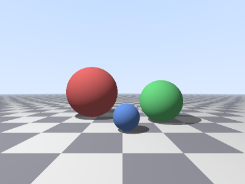

# miale-swa

Kifuatilia-miale (*raytracer*) kilichoandikwa kwa **Swa** safi -- lugha ya
mfumo ya Kiswahili inayojikusanya yenyewe, isiyotegemea libc kabisa.



Programu huchora duara tatu zenye rangi tofauti zilizosimama juu ya sakafu
ya ubao wa chesi, zikiangazwa na taa moja. Kila pikseli hufuatiliwa kwa
mwale halisi; picha huandikwa kama faili ya `miale.ppm`.

## Kilichomo

- **Vekta** ya vipimo vitatu (`D64`): jumlisha, toa, zidisha, bidhaa ya
  nukta, bidhaa ya msalaba, urefu, na kusawazisha (`vekta.swa`).
- **Mwale** na **duara**, pamoja na makutano ya mwale-duara kwa fomula ya
  quadratic (kwa `mzizi_hesabu` ya maktaba ya Swa) (`jiometri.swa`).
- **Mwanga wa diffuse** (Lambert): mwangaza hutegemea pembe kati ya
  kawaida ya uso na mwelekeo wa taa, pamoja na mwanga mdogo wa mazingira.
- **Vivuli**: mwale wa pili hutumwa kuelekea taa; kama duara lolote liko
  njiani, nukta iko kwenye kivuli. Mwale wa kivuli huanzia juu kidogo ya
  uso ili usigonge uso wake wenyewe (*shadow acne*).
- **Sakafu** ya ubao wa chesi, yenye ukungu unaoficha upeo wa macho.
- **Kamera ya mtazamo** (*perspective*) isiyobadilika.
- **Antialiasing** ya 2x2 (sampuli nne kwa pikseli) na marekebisho ya
  **gamma** (mzizi wa mraba).

Mandhari (duara, sakafu, taa, uangazaji) iko kwenye `mandhari.swa`;
`miale.swa` ina `main()` na kuandika picha.

## Mahitaji

- Linux (x86-64)
- Hazina ya mkusanyaji wa Swa: <https://github.com/lugha-swa/swa>
  (kwa chaguo-msingi inatarajiwa `~/Projects/compilers/swa`; vinginevyo
  weka `SWA_DIR`)

## Kujenga na kuendesha

```sh
git clone https://github.com/Sakajara/miale-swa
cd miale-swa

# (hiari) kama hazina ya Swa iko sehemu nyingine:
# export SWA_DIR=/njia/ya/swa

./jenga.sh miale.swa miale     # mara ya kwanza hujenga pia mnyororo wa mkusanyaji
./miale                        # huandika miale.ppm (400 x 300)
```

`miale.ppm` inaweza kufunguliwa na programu nyingi za picha, au
kubadilishwa kuwa PNG:

```sh
convert miale.ppm miale.png    # ImageMagick
```

Kuchora huchukua takriban sekunde moja hadi mbili.

## Majaribio

```sh
./jaribu.sh
```

Hii huendesha:

| Jaribio | Linakagua |
|---|---|
| `jaribu_vekta.swa` | shughuli zote za vekta, kwa thamani zilizokokotolewa kwa mkono |
| `jaribu_jiometri.swa` | makutano ya mwale-duara: mbele, kukosa, ndani ya duara, nyuma, mwelekeo usio wa urefu 1 |
| `jaribu_mandhari.swa` | vivuli (kituo cha kivuli kwenye sakafu, uso wa mbele na wa nyuma wa duara), sakafu, duara la karibu zaidi, rangi ya anga, na uangazaji wa diffuse kwa pembe ya kati (`0.6803`, `0.1512` -- kwa mkono) |
| `jaribu_picha.sh` | picha nzima: ukubwa na kichwa cha PPM, rangi za pikseli maalum, picha si tupu, na kuchora mara mbili kunatoa baiti sawa |

Majaribio ya mandhari yalithibitishwa kwa *mutation testing*: kuvunja
msimbo kwa makusudi (kuzima vivuli, kupuuza kawaida ya uso, kupuuza mwelekeo
wa taa, kubadilisha urefu wa sakafu, n.k.) hufanya majaribio kushindwa.

## Jinsi inavyofanya kazi (kwa ufupi)

Kwa kila pikseli, mwale huanzia kwenye jicho na kupita kwenye pikseli hiyo
kwenye ndege ya picha. Mwale hulinganishwa na duara zote tatu na sakafu;
makutano ya karibu zaidi (yenye `t > 0.001`) ndiyo yanayoonekana. Kwenye
nukta hiyo:

1. Kawaida ya uso `n` hukokotolewa (kwa duara: `(p - kituo) / nusu_kipenyo`).
2. Mwale wa kivuli hutumwa kutoka `p + 0.002·n` kuelekea taa. Kama duara
   lolote lipo kabla ya taa, mwanga wa diffuse ni sifuri.
3. Rangi = `rangi_msingi · (0.15 + 0.85 · max(0, n·L))`, ambapo `L` ni
   mwelekeo wa taa.

Mwale usiogonga kitu hupata rangi ya anga (mteremko wa nyeupe hadi buluu).

## Vidokezo kuhusu mkusanyaji wa Swa

Mambo yaliyojitokeza wakati wa kuandika programu hii (yanaweza kubadilika
mkusanyaji unavyoboreshwa):

- Wito unaopitisha **miundo kwa thamani** ukiwa ndani ya tawi la `sivyo`
  hushindwa kukusanya ("bafa ya miundo ya wito imejaa"), ingawa wito ule
  ule ndani ya `kama` hufanya kazi. Programu hii hutumia vitalu viwili vya
  `kama` badala ya `kama`/`sivyo` mahali hapo (angalia `mandhari.swa`).
- Kipengele cha safu ya miundo (`ulimwengu[i]`) hakiwezi kupitishwa moja kwa
  moja kama hoja ya muundo; kinanakiliwa kwanza kwenye kigezo cha ndani.
- Kianzio cha kigezo cha ulimwengu cha `D64` lazima kiwe namba halisi
  (`0.0 - 1.0` haikubaliwi), kwa hiyo `sakafu_y()` ni kazi.

## Leseni

MIT -- angalia [LICENSE](LICENSE).
